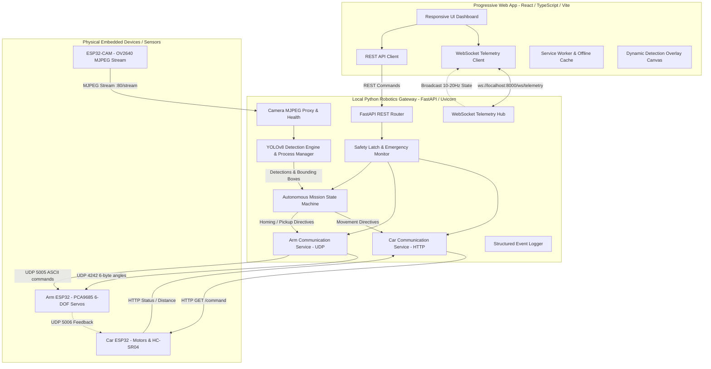

# WAREBOT — System Architecture & Data Flow

## Architectural Tenets
1. **Single Source of Truth**: The Gateway's `MissionService` owns autonomous execution. The browser never directly loops or sends repetitive forward commands; it issues high-level directives (`START_FOLLOWING`, `STOP_FOLLOWING`).
2. **Deterministic State Machine**:
   - `IDLE` -> `READY` -> `TARGET_SELECTED` -> `FOLLOWING` -> `STOPPED_AT_TARGET` -> `PICKUP` -> `COMPLETE`
   - Transitions respect hardware states (`MOVING_ALLOWED`, `PICKUP_STARTED`, `REVERSE_20_ACTIVE`).
3. **Decoupled Vision**: The YOLOv8 inference thread grabs frames asynchronously without blocking the camera network stream or WebSocket transmission.
4. **Safety Prioritization**: The Emergency Stop latch overrides all subsystem requests at the gateway level, instantly pushing `STOP` to the Car and halting the mission loop.
